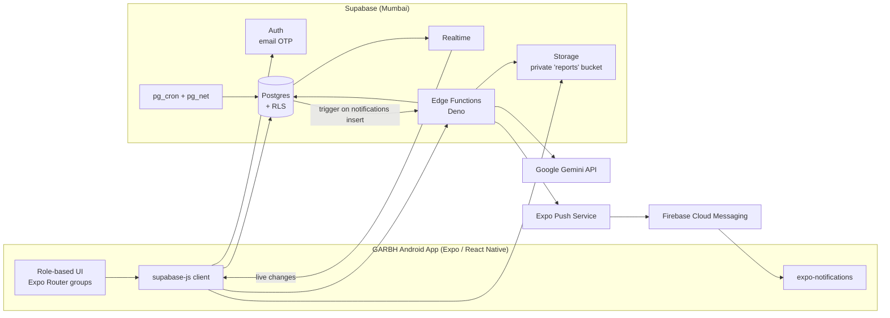
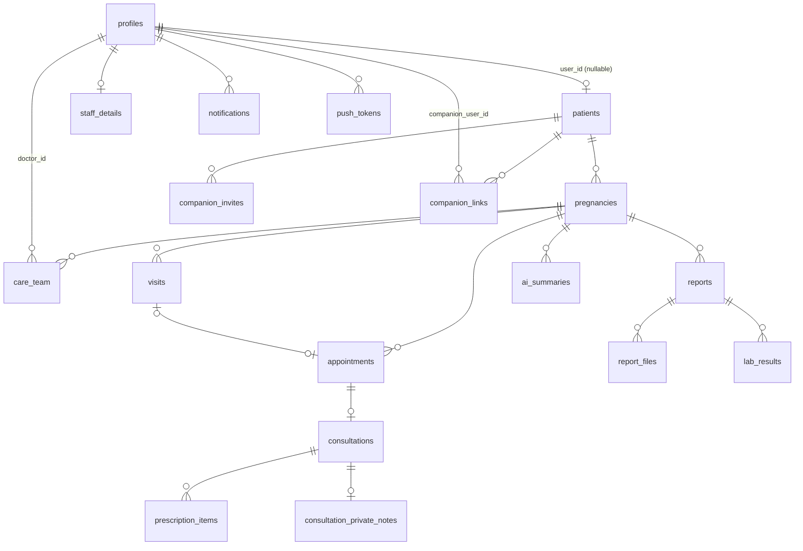

# GARBH (गर्भ — "womb") — Product & Technical Plan

A pregnancy-care Android app for a single hospital, with five role-based interfaces: **Doctor, Patient, Companion (relative), Receptionist, Admin**.

---

## 0. Decisions Locked In

| Topic | Decision |
|---|---|
| Platform | Android first, **React Native (Expo, TypeScript)**. The iOS build is possible later with almost no code change |
| App packaging | **One app**. The UI is chosen by role after login |
| Tenancy | **Single hospital** |
| Backend | **Supabase**: Postgres, Auth, Storage, Realtime, Edge Functions, pg_cron |
| AI | **Google Gemini**, called only from Supabase Edge Functions. No API key ships in the app |
| AI safety | **Doctor approves before the patient sees anything.** AI only produces drafts |
| Reports | **File upload** (PDF/photo) **plus structured values**. AI extracts the values and the doctor verifies or edits them |
| Auth | **Email OTP now** (free). **Phone OTP later** via MSG91/Twilio, once DLT registration is done |
| Language | English only (v1). Strings still go through an i18n layer so Hindi can be added cheaply |
| Companion access | Patient shares a **code**. The companion redeems it and the **patient approves**. The patient sets **per-companion permissions** and can revoke at any time |
| Patient onboarding | **Two routes:** (a) the patient **self-registers in the app** and is *unverified* until the receptionist verifies her at the desk and assigns an MRN; (b) the receptionist registers a walk-in, who gets an app invite |
| Appointments | **Patients book online in the app** into the doctor's free slots, and the booking is **confirmed instantly**. Receptionists can still book, move and cancel. Every change is visible live on all sides |
| Doctor access | Each pregnancy has a **care team**: one **primary doctor** plus **backup doctors** that the primary doctor names. **Only care-team doctors can see that patient's records.** Backups have ongoing access once named, and every view is audit-logged |
| Clinical review | An **obstetrician** must sign off the visit template, guidance lists, journey content and AI prompts before launch |

## 1. Assumptions (please confirm or correct)

These are not decided yet. I've made a reasonable default for each, and each one changes part of the plan.

1. At signup, the user picks **"I'm the patient"** or **"I'm a family member"**. That sets the role to `patient` or `companion` **once**. Nobody can make themselves a doctor, receptionist or admin. Staff are invite-only.
2. An **unverified** self-registered patient can see her journey (from the LMP she entered) and book **one** upcoming appointment. She can invite companions only **after** desk verification. This prevents spam bookings and fake records.
3. **Receptionists never see clinical data** (reports, vitals, prescriptions, summaries). They only see demographics, pregnancy dates and appointments.
4. **A patient can have multiple pregnancies over the years.** Clinical data hangs off a `pregnancy`, not off the person.
5. **Out of scope for v1:** billing/payments (including online payment at booking), postnatal and newborn care, video consultations, medication-intake reminders, chat, ABDM/ABHA integration, offline editing. Read-only offline caching *is* in scope.
6. **Doctors and receptionists use phones or tablets.** No separate web dashboard in v1. The layout should still work on tablets.
7. **Hosting region:** Supabase **ap-south-1 (Mumbai)**, for latency and Indian data-residency expectations.
8. **Admins can manage any care team** (e.g. when the primary doctor leaves the hospital) and keep full data access for hospital management. Every admin access is audit-logged.
9. **Booking rules (admin-configurable):** book at least 2h ahead and at most 60 days ahead; patients can cancel or reschedule up to 4h before; after that they have to call reception.

---

## 2. High-Level Architecture



**Principles**

- **Postgres is the source of truth, and RLS is the security boundary.** The app is treated as untrusted. Every permission rule lives in SQL policies and is covered by tests.
- **Privileged operations go through Edge Functions or `SECURITY DEFINER` RPCs**: creating staff users, redeeming companion codes, AI calls, sending push notifications.
- **Realtime runs on RLS-protected tables.** A patient's appointment subscription can only ever receive that patient's rows.
- **Everything clinical is audit-logged** by database triggers.

---

## 3. Tech Stack (detailed)

### Mobile app
| Concern | Choice | Why |
|---|---|---|
| Framework | Expo (latest stable SDK at project start), TypeScript strict | Managed native builds, OTA updates |
| Navigation | **Expo Router** (file-based) with route groups per role | Clean role separation |
| UI kit | **React Native Paper** (Material 3) | Android-native look, accessible, themeable (soft pink/maroon "Garbh" palette) |
| Server state | **TanStack Query** | Caching, retries, offline read cache via persister |
| Local state | **Zustand** (session, role, selected patient for companions) | Small and simple |
| Forms | **react-hook-form + zod** | Shared validation schemas |
| Supabase | `@supabase/supabase-js` v2 + generated DB types (`supabase gen types typescript`) | Type-safe queries |
| Session storage | Encrypted storage: AES key in `expo-secure-store`, ciphertext in AsyncStorage (the Supabase "LargeSecureStore" pattern) | Medical app, so tokens must not sit in plain text |
| Files | `expo-document-picker`, `expo-image-picker`, `expo-image-manipulator` (compress photos), `react-native-pdf` or WebView for viewing | Report upload and view |
| Charts | `victory-native` or `react-native-gifted-charts` | Weight/BP/Hb trends |
| Push | `expo-notifications` + FCM v1 credentials in EAS | Needs a **development build** (push doesn't work in Expo Go on Android) |
| Dates | `date-fns` | Gestational-age math on the client for display |
| i18n | `i18next` + `react-i18next` (English only for now) | Cheap to add Hindi later |
| Build/CI | **EAS Build / EAS Submit / EAS Update**, GitHub Actions | Play Store pipeline |
| Errors | Sentry (`@sentry/react-native`) with PII scrubbing | Crash visibility without leaking health data |

### Backend (Supabase)
| Concern | Choice |
|---|---|
| DB | Postgres. Extensions: `pgcrypto`, `btree_gist` (no double-booking), `pg_cron`, `pg_net` |
| Auth | Email OTP (6-digit code template). **Custom SMTP** via Resend or Brevo, because Supabase's built-in SMTP is heavily rate-limited and not for production |
| Storage | Private bucket `reports`, accessed only through RLS policies and signed URLs |
| Realtime | `postgres_changes` on `appointments`, `notifications`, `companion_links`, `ai_summaries` (doctor inbox). Can move to Realtime Broadcast-from-DB if scale demands it |
| Edge Functions | `admin-users`, `process-report`, `summarize-consultation`, `send-push`, `export-patient-data` |
| Scheduling | `pg_cron` for appointment reminders, visit-due alerts, expiring codes, overdue-verification nudges |
| Local dev | Supabase CLI (`supabase start`), migrations in git, `seed.sql` with demo hospital data |
| Tests | **pgTAP** (`supabase test db`) for RLS and functions, Deno tests for Edge Functions |

### AI
- **Gemini Flash-tier model** (e.g. `gemini-2.5-flash` or the newest Flash at build time) for extraction and summaries. A **Pro-tier** model is used for cumulative pregnancy summaries if Flash quality isn't good enough. The model name is an env var (`GEMINI_MODEL`).
- **Structured output** (`responseMimeType: application/json` + `responseSchema`), so responses are machine-validated.
- PDFs and images are sent as inline data (under 20 MB) or through the Gemini File API.
- ⚠️ **Use the paid tier, or Vertex AI.** On the Gemini API **free tier, Google may use your prompts to improve its products**, which is not acceptable for patient health data. Paid tier or Vertex AI (region `asia-south1`) gives data-use terms suitable for health data.

### Cost snapshot (approximate, v1 scale ≈ a few hundred patients)
| Item | Cost |
|---|---|
| Supabase | Free tier for dev. **Pro (~$25/mo)** for production (daily backups, no pausing) |
| Gemini Flash | A few rupees per report summary. Likely < ₹1–2k/month at this scale |
| Email (Resend/Brevo) | Free tier (3k–9k emails/month) |
| Phone OTP (later) | MSG91 ≈ ₹0.15–0.25/SMS + DLT registration |
| Google Play developer account | $25 one-time |
| Expo/EAS | Free tier is fine at first |

---

## 4. Roles & Permissions Matrix

`R` = read, `W` = create/update, `D` = delete, `—` = no access, `own` = only their own / linked data, **`team`** = only pregnancies where this doctor is on the care team (primary or backup)

| Resource | Admin | Doctor | Receptionist | Patient | Companion |
|---|---|---|---|---|---|
| Staff accounts | RWD | R (self) | R (doctors list) | R (public doctor directory: name, specialization, photo) | — |
| Patient demographics | RWD | RW team | RW (+ verify self-registered) | R own (edit contact only); W at self-registration | R (name, if linked) |
| Pregnancy (LMP/EDD/risk) | RWD | RW team | R, W (LMP at registration) | R own; W LMP at self-registration only | R if `journey` perm |
| Care team | RWD | R team; **primary** adds/removes backups | R (to know which doctors can be booked) | R own (names of her doctors) | R if `appointments` perm |
| Visit plan | RWD | RW team | R | R own | R if `journey` perm |
| Appointments | RWD | R team, W status | RWD | R own; **book / reschedule / cancel own** (via RPC, rules apply) | R if `appointments` perm |
| Doctor availability / free slots | RWD | RW own | R | R (free slots only, via RPC) | — |
| Consultations (vitals, advice) | RWD | RW team | — | R own (published fields) | R if `summaries` perm |
| Doctor private notes | R | RW team | — | — | — |
| Prescriptions | RWD | RW team | — | R own | R if `prescriptions` perm |
| Reports (files + values) | RWD | RW team | — | R own | R if `reports` perm |
| AI summaries | RWD | RW team (draft/approve) | — | R own, **published only** | R if `summaries` perm, published only |
| Companion links | RWD | R team | — | RW own (approve/revoke/perms); create invites only once verified | R own, create (via code), D (leave) |
| Journey content / templates / lab catalog | RWD | R | R | R | R |
| Audit log | R | — | — | — | — |

---

## 5. Data Model



### 5.1 Enums
```sql
create type user_role         as enum ('admin','doctor','receptionist','patient','companion');
create type pregnancy_status  as enum ('active','delivered','miscarriage','terminated','transferred','closed');
create type risk_level        as enum ('low','moderate','high');
create type visit_status      as enum ('planned','scheduled','completed','missed','skipped','cancelled');
create type appt_status       as enum ('booked','confirmed','checked_in','in_consultation','completed','cancelled','no_show');
create type report_type       as enum ('blood','urine','ultrasound','nt_scan','anomaly_scan','growth_scan','doppler','gtt','thyroid','ecg','other');
create type extraction_status as enum ('pending','processing','done','failed','skipped');
create type summary_status    as enum ('generating','draft','approved','published','rejected','failed');
create type summary_source    as enum ('report','consultation','cumulative');
create type link_status       as enum ('pending','approved','rejected','revoked','left');
create type care_role         as enum ('primary','backup');
create type booking_channel   as enum ('app','reception','doctor','admin');
create type result_source     as enum ('ai_extracted','manual');
```

### 5.2 Tables (key columns)

**Identity**
- `profiles`: `id (= auth.users.id)`, `role user_role` (**nullable** until onboarding), `full_name`, `email`, `phone`, `avatar_path`, `is_active`, `created_at`, `deleted_at`
  - Created by a trigger on `auth.users` insert. Staff invited by the admin and desk-registered patients get their role from the invite metadata. A self-signup starts with `role = null` and picks `patient` or `companion` **exactly once** through the `complete_signup()` RPC.
  - The `role` column is **not updatable by the user** after that. This is enforced by a trigger and column privileges.
- `staff_details`: `profile_id`, `designation`, `specialization`, `registration_no` (medical council number for doctors), `signature_path`, `bio`, `accepts_new_patients bool` (whether self-registered patients can pick this doctor for a first visit)
- `doctor_directory` (view): public doctor fields only (name, photo, specialization, bio, accepts_new_patients), readable by patients
- `hospital_settings` (single row): name, address, phone, logo, timezone (`Asia/Kolkata`), default slot length, reminder lead times, **booking rules** (`min_lead_hours = 2`, `max_advance_days = 60`, `patient_cancel_cutoff_hours = 4`, `unverified_max_upcoming = 1`, `verified_max_upcoming = 3`)

**Patient & pregnancy**
- `patients`: `id`, `user_id (nullable, unique → profiles)`, `mrn` (hospital number, unique, **nullable until verified**), `full_name`, `dob`, `phone`, `email`, `address`, `blood_group`, `rh_negative bool`, `allergies text[]`, `chronic_conditions text[]`, `emergency_contact`, `registration_source` (`app|desk`), `verified_at`, `verified_by`, `consent_ai_at`, `consent_data_at`, `created_by`, `created_at`, `deleted_at`
  - `is_verified` = `verified_at is not null`. Desk-registered patients are verified on creation.
- `pregnancies`: `id`, `patient_id`, `lmp_date`, `lmp_source` (`patient_reported|clinician`), `edd_lmp` (generated: `lmp + 280 days`), `edd_usg` (dating scan override), `edd_final` (generated: `coalesce(edd_usg, edd_lmp)`), `gravida`, `para`, `abortus`, `living`, `multiple_gestation smallint default 1`, `risk_level`, `risk_factors text[]`, `status`, `outcome_date`, `outcome_notes`, `created_at`
  - Partial unique index: **one `active` pregnancy per patient**.
- `care_team`: `id`, `pregnancy_id`, `doctor_id`, `care_role` (`primary|backup`), `added_by`, `added_at`, `removed_at`, `removed_by`, `note` (e.g. "Covers Dr. A's leave")
  - Partial unique index: **exactly one active `primary`** per pregnancy (`where care_role = 'primary' and removed_at is null`).
  - Unique active `(pregnancy_id, doctor_id)`.
  - Only the **primary doctor** or an **admin** can add or remove backups. Changing the primary is admin-only, or a "hand over" by the current primary that the receptionist cannot do.
  - Removing a doctor sets `removed_at` (soft). Access ends immediately, but history stays in the audit trail.

**Visit plan (the 12+ visits)**
- `visit_templates` (admin-editable default schedule): `id`, `seq`, `target_week`, `window_start_week`, `window_end_week`, `title`, `purpose`, `recommended_tests text[]`, `is_active`
- `visits` (per pregnancy, generated from the template, then editable): `id`, `pregnancy_id`, `seq`, `target_week`, `due_from date`, `due_to date`, `title`, `purpose`, `recommended_tests`, `status`, `appointment_id`, `added_by`, `reason_added` (e.g. "High BP follow-up"), `is_extra bool`

**Appointments**
- `doctor_availability`: `doctor_id`, `weekday`, `start_time`, `end_time`, `slot_minutes`
- `doctor_time_off`: `doctor_id`, `starts_at`, `ends_at`, `reason`
- `appointments`: `id`, `patient_id`, `pregnancy_id`, `doctor_id`, `visit_id (nullable)`, `starts_at`, `ends_at`, `status`, `reason`, `notes_for_patient`, `booked_by`, `booking_channel` (`app|reception|doctor|admin`), `rescheduled_from (nullable → appointments)`, `cancelled_by`, `cancelled_reason`, `reminder_24h_sent_at`, `reminder_2h_sent_at`, `checked_in_at`, `created_at`, `updated_at`
  - The `doctor_id` **must be on the pregnancy's active care team**, enforced by a trigger. The one exception is an unverified patient's first booking with a doctor who has `accepts_new_patients`: that booking also adds the doctor to the care team as `primary`.
  - **No double-booking**, enforced in the DB (this also resolves two patients grabbing the same slot online at the same moment, because the second insert fails):
    ```sql
    alter table appointments add constraint no_doctor_overlap
      exclude using gist (doctor_id with =, tstzrange(starts_at, ends_at) with &&)
      where (status not in ('cancelled','no_show'));
    ```

**Consultation (the doctor's record of a visit)**
- `consultations`: `id`, `appointment_id`, `pregnancy_id`, `doctor_id`, `ga_weeks`, `ga_days` (snapshotted), vitals (`weight_kg`, `bp_systolic`, `bp_diastolic`, `pulse`, `temperature`, `spo2`), obstetric exam (`fundal_height_cm`, `fetal_heart_rate`, `presentation`, `fetal_movements`, `edema`), urine dipstick (`urine_albumin`, `urine_sugar`), `complaints`, `findings`, **`advice`** (free text shown to patient), `diet_advice`, `next_visit_after_weeks`, `published_at`, `created_at`
- `consultation_private_notes`: `consultation_id`, `note` (doctors only, never shown to patient or companion)
- `prescription_items` (**manual entry**): `id`, `consultation_id`, `pregnancy_id`, `drug_name`, `strength`, `dosage_form`, `dose`, `frequency` (e.g. `1-0-1`), `timing` (before/after food), `route`, `duration_days`, `start_date`, `end_date` (generated), `instructions`, `is_active` (generated from dates or stopped flag)
- `drug_catalog` (optional autocomplete, admin-managed): `name`, `generic`, `common_strengths`, `pregnancy_caution_note`

**Reports**
- `reports`: `id`, `pregnancy_id`, `consultation_id (nullable)`, `type report_type`, `title`, `report_date`, `lab_name`, `uploaded_by`, `extraction_status`, `extraction_error`, `doctor_comment`, `verified_by`, `verified_at`, `created_at`, `deleted_at`
- `report_files`: `id`, `report_id`, `storage_path`, `mime_type`, `page_no`, `size_bytes`
- `lab_tests` (catalog, admin-managed): `code` (HB, TSH, FBS, PPBS, OGTT_1H, PLT, HBA1C, VDRL, HIV, HBSAG, URINE_PROT, …), `name`, `unit`, `ref_low`, `ref_high`, `trimester_ref jsonb` (trimester-specific ranges, e.g. TSH)
- `lab_results`: `id`, `report_id`, `pregnancy_id`, `test_code`, `value_num`, `value_text`, `unit`, `ref_low`, `ref_high`, `flag` (`low|normal|high|abnormal`), `source result_source`, `confidence`, `verified bool`, `verified_by`, `observed_on`
  - Charts and trends only use `verified = true` values.

**AI**
- `ai_summaries`: `id`, `pregnancy_id`, `source_type`, `source_id`, `status`, `model`, `prompt_version`, `input_hash`, `draft jsonb`, `final jsonb` (doctor-edited), `doctor_note`, `generated_at`, `reviewed_by`, `reviewed_at`, `published_at`, `token_usage jsonb`, `error`
- `curated_guidance` (admin/OB-reviewed static content): `kind` (`food_avoid|food_recommend|med_avoid|warning_sign`), `trimester (nullable = all)`, `condition (nullable, e.g. 'gdm','anemia','hypertension')`, `text`, `reason`, `is_active`. The AI output is always **merged with** this list, never a replacement for it.

**Journey content**
- `week_content`: `week (4–42)`, `baby_size_label` (e.g. "Mango"), `baby_length_cm`, `baby_weight_g`, `baby_development`, `mother_changes`, `tips`, `image_path`
- `milestones`: `key`, `title`, `week_from`, `week_to`, `description`, `category` (`scan|test|vaccine|education|trimester`), e.g. NT scan 11–13+6, anomaly scan 18–22, OGTT 24–28, Td doses, anti-D at 28 if Rh-negative, growth scan 32–36, birth plan 34+.

**Companions**
- `companion_invites`: `id`, `patient_id`, `code_hash` (sha256 of code + server pepper), `expires_at` (24h), `max_uses` (1), `used_at`, `revoked_at`, `created_at`
- `companion_links`: `id`, `patient_id`, `companion_user_id`, `relation` (`husband|mother|father|mother_in_law|father_in_law|sibling|friend|other`), `relation_note`, `status`, permissions (`can_view_appointments`, `can_view_journey`, `can_view_summaries`, `can_view_reports`, `can_view_prescriptions`, `receive_notifications`), `requested_at`, `decided_at`
  - Unique: `(patient_id, companion_user_id)` where status in (`pending`, `approved`).
- `code_redeem_attempts`: `user_id`, `attempted_at`, `success` (rate limiting)

**Notifications & audit**
- `notifications`: `id`, `user_id`, `type` (`appointment_booked|appointment_changed|appointment_reminder|summary_published|report_added|companion_request|companion_approved|visit_due|…`), `title`, `body`, `data jsonb` (deep-link target), `read_at`, `push_sent_at`, `push_error`, `created_at`
- `push_tokens`: `user_id`, `expo_push_token` (unique), `platform`, `last_seen_at`
- `audit_log`: `id`, `actor_id`, `actor_role`, `action` (`insert|update|delete|view_sensitive|export`), `table_name`, `record_id`, `patient_id`, `old jsonb`, `new jsonb`, `at`. Written by a generic trigger on clinical tables. Append-only, with no update/delete policy for anyone.

### 5.3 Core SQL functions
```sql
-- Who am I?
create function auth_role() returns user_role ... security definer stable;   -- reads profiles.role for auth.uid()
create function is_staff() returns boolean ...;                             -- admin/doctor/receptionist
create function my_patient_id() returns uuid ...;                           -- patients.id where user_id = auth.uid()
create function companion_can(p_patient uuid, p_perm text) returns boolean ...; -- approved link + permission flag
create function on_care_team(p_pregnancy uuid) returns boolean ...;         -- auth.uid() is an active primary/backup doctor
create function on_patient_care_team(p_patient uuid) returns boolean ...;   -- on the care team of ANY of the patient's pregnancies
create function is_primary_doctor(p_pregnancy uuid) returns boolean ...;

-- Onboarding (SECURITY DEFINER)
create function complete_signup(p_kind text, p_details jsonb) returns void;
  -- only if profiles.role is null; 'companion' → role only;
  -- 'patient' → role + patients row (registration_source='app', unverified) + active pregnancy (lmp_source='patient_reported')
create function verify_patient(p_patient uuid, p_mrn text, p_merge_into uuid default null) returns void;
  -- receptionist/admin; sets verified_at + MRN; optionally merges into an existing desk record (same person)

-- Care team (SECURITY DEFINER; caller must be primary doctor or admin)
create function add_backup_doctor(p_pregnancy uuid, p_doctor uuid, p_note text) returns void;
create function remove_care_team_member(p_pregnancy uuid, p_doctor uuid) returns void;
create function hand_over_primary(p_pregnancy uuid, p_new_primary uuid) returns void;   -- old primary becomes backup (or removed)

-- Online booking (SECURITY DEFINER; the only way a patient can write appointments)
create function available_slots(p_doctor uuid, p_from date, p_to date) returns table (starts_at timestamptz, ends_at timestamptz);
  -- availability − time off − existing active appointments; respects min lead time / max advance
create function book_appointment(p_doctor uuid, p_starts_at timestamptz, p_visit uuid default null) returns uuid;
create function reschedule_appointment(p_appt uuid, p_new_starts_at timestamptz) returns uuid;  -- cancels old, books new, links rescheduled_from
create function cancel_appointment(p_appt uuid, p_reason text) returns void;
  -- patient path enforces: own active pregnancy, doctor on care team (or first-visit rule), slot really free,
  -- within lead/advance windows, cancel cutoff, max upcoming appointments (1 unverified / 3 verified)

-- Pregnancy math (server-side source of truth; the client mirrors it for display)
create function gestational_age(p_pregnancy uuid, p_on date default current_date)
  returns table (weeks int, days int, trimester int, days_to_edd int);
  -- GA = (p_on - (edd_final - 280)); trimester: <14w → 1, <28w → 2, else 3

-- Visit plan generation (called by a trigger when a pregnancy is created or the LMP changes)
create function generate_visit_plan(p_pregnancy uuid) returns void;
  -- inserts one visit per active visit_template, due_from/due_to computed from LMP

-- Companion flow (SECURITY DEFINER RPCs)
create function create_companion_invite() returns text;                        -- patient only; returns plaintext code once
create function redeem_companion_code(p_code text, p_relation text) returns uuid; -- creates pending link
create function decide_companion_link(p_link uuid, p_approve bool, p_perms jsonb) returns void;
```

### 5.4 Default visit template (12 visits, admin-editable)

Based on common Indian obstetric practice: monthly until 28 weeks, fortnightly until 36, then weekly. **An OB must review it before go-live.**

| # | Target week | Window | Purpose | Typical tests |
|---|---|---|---|---|
| 1 | 8 | 6–10 | Booking visit, confirm pregnancy, dating, history | CBC, blood group & Rh, TSH, FBS/HbA1c, HIV, HBsAg, VDRL, urine R/M, viability/dating USG |
| 2 | 12 | 11–13+6 | NT scan & first-trimester screening | NT scan, double marker |
| 3 | 16 | 15–17 | Routine; review screening | Quadruple marker (if needed), urine |
| 4 | 20 | 18–22 | Anomaly scan | Level-II anomaly scan |
| 5 | 24 | 23–25 | Routine | Hb |
| 6 | 28 | 26–28 | Third trimester begins; GDM screen | OGTT 75g, CBC, anti-D if Rh-neg, Td |
| 7 | 30 | 29–31 | Routine | BP, urine |
| 8 | 32 | 31–33 | Growth assessment | Growth scan ± Doppler |
| 9 | 34 | 33–35 | Routine; birth plan discussion | CBC |
| 10 | 36 | 35–37 | Presentation check, delivery planning | Repeat Hb, urine, consider GBS per protocol |
| 11 | 38 | 37–39 | Routine | NST if indicated |
| 12 | 40 | 39–40+6 | Due-date review; plan if overdue | NST, AFI |

The doctor can **add extra visits** (`is_extra`, with a reason), **skip, move or cancel** visits, and **change any visit's tests**. A **high-risk** pregnancy can be given a denser template (e.g. fortnightly from 20 weeks) with one tap.

---

## 6. Row-Level Security (sketch)

Every table has RLS enabled and **default deny**. Representative policies:

```sql
-- patients
create policy desk_read    on patients for select using (auth_role() in ('admin','receptionist'));
create policy doc_read     on patients for select using (auth_role() = 'doctor' and on_patient_care_team(id));
create policy self_read    on patients for select using (user_id = auth.uid());
create policy comp_read    on patients for select using (companion_can(id, 'any'));
create policy desk_write   on patients for insert with check (auth_role() in ('admin','receptionist'));
create policy staff_update on patients for update using (auth_role() in ('admin','receptionist') or (auth_role() = 'doctor' and on_patient_care_team(id)));
create policy admin_delete on patients for delete using (auth_role() = 'admin');
-- (patient self-registration inserts go through complete_signup(), not a policy)

-- consultations: NO receptionist policy at all → invisible to receptionists;
-- doctors only for pregnancies where they are on the care team
create policy admin_all   on consultations for all    using (auth_role() = 'admin');
create policy team_all    on consultations for all    using (auth_role() = 'doctor' and on_care_team(pregnancy_id))
                                                      with check (auth_role() = 'doctor' and on_care_team(pregnancy_id));
create policy patient_rd  on consultations for select using (published_at is not null and pregnancy_id in (select id from pregnancies where patient_id = my_patient_id()));
create policy comp_rd     on consultations for select using (published_at is not null and companion_can((select patient_id from pregnancies p where p.id = pregnancy_id), 'summaries'));

-- ai_summaries: patients/companions only ever see status = 'published', and only the `final` JSON
--   (exposed through a view `published_summaries` that omits draft + model metadata)

-- appointments: receptionist/admin full CRUD; care-team doctor read + status update;
--   patient/companion read; patients have NO insert/update policy → they can only write via book/reschedule/cancel RPCs

-- care_team: read by admin, receptionist, care-team doctors, the patient, and companions with 'appointments';
--   writes only via add_backup_doctor / remove_care_team_member / hand_over_primary RPCs
```

The same `on_care_team(pregnancy_id)` check applies to **every clinical table**: visits (write), consultations, private notes, prescription items, reports, report files, lab results and AI summaries. A doctor who is not on the care team gets **zero rows**, not an error, so the patient doesn't exist for them. When a doctor is removed from the care team, Realtime and RLS cut access immediately.

**Storage (`reports` bucket)**: the path convention is `{patient_id}/{pregnancy_id}/{report_id}/{file_id}.{ext}`. Policies on `storage.objects` parse the second path segment (`pregnancy_id`) and apply the same rules as `reports`. Care-team doctors and admins can write, and the patient and companions (with the `reports` permission) can read. Files are downloaded via short-lived signed URLs (60s).

**Column-level protections**
- `profiles.role` and `profiles.is_active` can't be updated by the user (trigger checks `auth_role() = 'admin'`, otherwise it raises).
- A patient may update only `phone`, `email`, `address` and `emergency_contact` on their own `patients` row. This is enforced by a `BEFORE UPDATE` trigger that compares the other columns.

**RLS must be tested.** A pgTAP test is written for each role × table × operation (see §13). This is the single most important quality gate in the project.

---

## 7. Feature Specs by Interface

### 7.1 Shared
- **Login:** enter email → get a 6-digit code → verify. On first login a patient accepts the **Terms + Privacy + AI-processing consent** (stored with a timestamp).
- **Onboarding** (self-signups only, i.e. `role = null`): "Who are you?" → **I'm pregnant (patient)** or **I'm a family member (companion)**.
  - Patient: name, DOB, phone, LMP (or "I know my due date"), first pregnancy? (simple G/P), known allergies and conditions → **"Book your first visit"** (pick a doctor accepting new patients → slot). She then sees a banner: *"Bring a photo ID to your first visit to verify your account."*
  - Companion: goes to the code-entry screen (§7.3).
- **Role router:** after the session loads, fetch the profile and redirect to onboarding (`role = null`), `/(admin)`, `/(doctor)`, `/(reception)`, `/(patient)` or `/(companion)`. Deactivated users are signed out and shown "Contact hospital".
- **Notifications inbox:** live via Realtime. Tapping one deep-links into the screen it refers to.
- **Profile & settings:** name, photo, notification preferences, sign out, **delete my account** (a Play Store requirement; creates a deletion request that the admin processes, since clinical records have legal retention requirements).

### 7.2 Patient
1. **Home**
   - **Journey card:** "Week 22 + 3 days · 2nd Trimester", progress ring to EDD, "Your baby is the size of a papaya 🍈", days to go.
   - **Next appointment** card (live): date, time, doctor, status chip, "Add to calendar".
   - **Latest doctor-approved summary** (headline + 3 key points).
   - **Today's medicines** (active prescription items).
   - **Alerts**, e.g. "OGTT due between 24–28 weeks. Not booked yet."
2. **Journey** (the "journey flow")
   - A horizontal **trimester timeline** (T1 → T2 → T3 → Delivery) with a "You are here" marker.
   - A vertical **milestone path**: completed visits ✅, the current week, upcoming visits and scans with due windows, vaccines, and key tests. Each node can be tapped for details.
   - A **week-by-week** swiper with baby development, changes in the mother, and tips.
   - **What's next:** the next 2–3 stages, each explained in plain language.
3. **Appointments:** upcoming and past, updated in real time as the receptionist changes them. The status timeline is booked → checked-in → in consultation → done.
   - **Book online:** "Book next visit" is pre-filled from the next planned visit (e.g. "Visit 6 · 28 weeks · OGTT, due 4–18 Mar") → choose a doctor from **her care team** (primary first, backups next; the primary shows "On leave" when unavailable) → a date strip with free slots → confirm. The booking is **instantly confirmed** and appears on the receptionist's and doctor's screens live.
   - Slots outside the visit's due window are still allowed, with a soft warning ("Your doctor recommends 26–28 weeks").
   - **Reschedule / cancel** in the app up to the cutoff (default 4h before). After that: "Please call reception" with a tap-to-call button.
   - If someone else takes the slot while she is on the confirm screen, the DB rejects the second booking, and she sees "That slot was just taken" with refreshed slots.
   - **Unverified** patients: one upcoming appointment, and a "Verify at your first visit" banner.
4. **My doctors:** her care team (primary + backups) with photo and specialization.
5. **Reports & Summaries**
   - A list of reports grouped by visit or trimester, with a type icon, date and "Doctor reviewed" badge.
   - Report detail: the original file viewer, extracted values with normal/abnormal chips, and the doctor-approved summary.
   - **Trends:** Hb, weight, BP and sugar charts across the pregnancy, using verified values only.
6. **Care guide:** a combined, deduplicated view of:
   - 🥗 **Eat more**, 🚫 **Avoid eating**, 💊 **Medicines to avoid / check with doctor first**, ⚠️ **Warning signs, go to hospital now** (bleeding, severe headache, reduced fetal movements, leaking fluid, etc.)
   - The source is `curated_guidance` (static, OB-reviewed) merged with the latest **published** AI summary personalisation. Each item is labelled "Advised by Dr. X" or "General guidance".
7. **Prescriptions:** current medications, plus history per visit (the doctor's manual entries exactly as written, along with the doctor's advice text).
8. **My Companions** (available once verified): generate an invite code, see pending requests (approve with permission toggles, or reject), list approved companions (edit permissions, revoke).

### 7.3 Companion
- **First run:** "Enter the code shared by your family member" + relation picker → status "Waiting for approval" (updates in real time).
- **Patient switcher**, for when a companion is linked to more than one patient (e.g. a mother following two daughters).
- **Read-only** versions of Home, Journey, Appointments, Summaries, Reports and Prescriptions. Each section is **hidden, not just disabled**, if the permission is off.
- Gets appointment reminders and summary-published notifications if `receive_notifications` is on.
- "Leave" removes the link.

### 7.4 Doctor
1. **Today:** live queue of today's appointments (Booked → **Checked in by reception** shows up in real time → In consultation → Done). New online bookings appear live, with an "App" badge. Tap to start the consultation.
2. **Patients:** only patients whose care team includes this doctor. Search by name or MRN. Filters: **primary / backup**, high risk, trimester, overdue visits.
3. **Patient chart** (one pregnancy):
   - Header: name, age, G/P/A/L, blood group, Rh, allergies (red chips), GA/trimester, EDD, risk badge, an **"Unverified / LMP patient-reported"** chip when relevant, and the care team.
   - **Care team panel** (primary doctor): add a backup from the doctor list with an optional note, remove a backup, or **hand over primary**. Backups see the panel read-only.
   - Tabs: **Timeline** (visits, consultations, reports in order), **Vitals trends**, **Reports**, **Prescriptions**, **Visit plan**, **AI summaries**.
4. **Consultation form** (one screen, sectioned, autosaves a draft):
   - Vitals → obstetric exam → complaints and findings → **Advice (shown to patient)** → **Prescription (manual entry rows** with drug autocomplete from `drug_catalog`, dose, frequency `1-0-1`, timing, duration, instructions; "copy from last visit") → private notes → next visit.
   - **Publish:** makes advice and prescription visible to the patient and companions, notifies them, and optionally triggers an AI patient-friendly consultation summary (as a draft for review).
5. **Add report:** pick a type, date and file(s) (multi-page photos or a PDF), upload with a progress bar, then tap **"Extract & summarise with AI"**.
6. **AI Review inbox** (realtime badge count)
   - Split view: original file | extracted values table (editable, with low-confidence values highlighted) | summary draft (editable sections).
   - Actions: **Approve & Publish**, **Save draft**, **Regenerate**, **Reject**. Every edit is kept (draft vs final) for quality tracking.
7. **Visit plan editor:** add extra visit (week + reason + tests), move, skip or cancel, switch to the high-risk template.
8. **Pregnancy management:** set or update the LMP or dating-scan EDD, set risk level and factors, record the outcome (delivered/other), which closes the pregnancy.
9. **My schedule:** set weekly availability and time off. Adding time off that clashes with booked appointments lists those appointments, so they can be moved to a backup doctor (patient notified) or handed to reception to rebook. The doctor can also toggle **"Accepting new patients"**.

### 7.5 Receptionist
1. **Register patient (walk-in):** demographics, MRN (auto-generated or manual), email (needed for the app invite), LMP, assign **primary doctor**, record consent. Saving creates the patient, the pregnancy, the care team (primary), the auto-generated **12-visit plan**, and an app invite email.
   - Duplicate check on phone, name and DOB before saving.
2. **Verify app registrations:** a queue of self-registered patients (today's arrivals at the top). Check photo ID → assign MRN → confirm or correct details. If the patient already exists as a desk record, **merge** them. On verification the patient is notified and companion invites unlock.
3. **Appointment book:** a day/week calendar per doctor showing free slots (from availability minus time off minus existing bookings), with **online bookings shown live and tagged "App"**. Book, reschedule or cancel, and link the appointment to a planned visit. Only doctors on the patient's care team can be picked. The patient sees every change **instantly**, plus a push notification.
4. **Visits due:** a worklist of planned visits whose window opens in the next 14 days and have no appointment, or are overdue. Includes one-tap booking and a "Called patient" note. Patients who self-book drop off the list automatically.
5. **Today's desk:** check patients in (the doctor sees it live) and mark no-shows.
6. **Doctor unavailable:** when a doctor adds time off, the affected appointments show up here for rebooking with a backup or a new time.
7. Never sees reports, vitals, prescriptions or AI summaries.

### 7.6 Admin (hospital management)
1. **Dashboard:** active pregnancies by trimester, high-risk count, appointments today/this week, no-show rate, AI summaries pending review, unverified lab values, missed visits.
2. **Users:** create doctors, receptionists and admins (via the `admin-users` Edge Function using the service role: invite email + set role); edit, deactivate/reactivate, resend invite, change role.
3. **Patients & pregnancies:** full CRUD, **merge duplicate patients**, fix the LMP/EDD, **manage care teams** (change primary, add or remove backups, e.g. when a doctor leaves the hospital), soft-delete or restore, hard delete (double confirmation, reason required, audit-logged).
4. **Data quality center** ("admin makes sure data is correct"):
   - Pregnancies with no LMP/EDD, GA > 42 weeks still active, **pregnancies with no active primary doctor**, **care teams whose only doctor is deactivated**, third-trimester pregnancies with no backup doctor, unverified app registrations older than 14 days, appointments in the past still "booked", consultations without published advice, lab values unverified > 48h, AI drafts pending > 24h, patients without an app account, out-of-range values (e.g. BP 300/20) flagged as likely typos.
   - Each item links to a fix screen.
5. **Configuration:** booking rules (lead time, advance window, cancel cutoff, max upcoming), visit templates (standard and high-risk), lab test catalog and reference ranges, drug catalog, curated guidance lists, week-by-week journey content, milestones, hospital settings, reminder timings.
6. **Audit log viewer:** filter by user, patient, table and date.
7. **Requests:** account deletion and data export (DPDP) requests.

---

## 8. Key Flows

### 8.1 Companion access (code + approval)
```mermaid
sequenceDiagram
  participant P as Patient
  participant DB as Supabase (RPC)
  participant C as Companion
  P->>DB: create_companion_invite()
  DB-->>P: code "K7M-Q2P" (valid 24h, single use; only the hash is stored)
  P->>C: shares code (WhatsApp/SMS via Android share sheet)
  C->>C: signs up with email OTP (role = companion)
  C->>DB: redeem_companion_code("K7MQ2P", "husband")
  DB->>DB: rate-limit check (≤5 failed attempts/hour/user), validate hash + expiry
  DB-->>C: link status = pending
  DB->>P: notification "Rahul (husband) wants to follow your pregnancy"
  P->>DB: decide_companion_link(approve, perms{appointments, journey, summaries, reports?, prescriptions?})
  DB->>C: notification "Access approved" (Realtime updates their screen)
  Note over P,C: Patient can change permissions or revoke at any time
```
- **Code format:** 6 characters from an unambiguous alphabet (no 0/O/1/I/L), shown as `XXX-XXX`. That gives ~887M combinations, which together with the rate limit and 24h expiry is safe against brute force.
- Only **one active invite** at a time per patient. Generating a new one revokes the old one.

### 8.2 Report → AI summary → doctor approval → patient
```mermaid
sequenceDiagram
  participant D as Doctor app
  participant ST as Storage
  participant DB as Postgres
  participant EF as Edge Fn process-report
  participant G as Gemini
  participant P as Patient/Companion
  D->>ST: upload files (RLS: doctor only)
  D->>DB: insert reports + report_files (extraction_status=pending)
  D->>EF: invoke process-report(report_id) [JWT]
  EF->>DB: verify caller is a doctor on this pregnancy's care team; load context (GA, trimester, allergies, conditions, active meds, last values)
  EF->>ST: download files (service role)
  EF->>G: files + de-identified context + JSON schema
  G-->>EF: { lab_values[], summary{} }
  EF->>EF: validate with zod; map test names → lab_tests codes; compute flags vs ref ranges
  EF->>DB: insert lab_results (source=ai, verified=false), ai_summaries (status=draft)
  DB-->>D: Realtime: AI inbox +1
  D->>DB: edit values/summary → approve & publish
  DB->>DB: trigger: lab_results.verified=true, summary.status=published, insert notifications
  DB->>P: push + Realtime update
```

### 8.3 Self-registration → first booking → desk verification
```mermaid
sequenceDiagram
  participant P as New patient (app)
  participant DB as Supabase
  participant R as Receptionist
  participant D as Doctor
  P->>DB: email OTP sign-up → complete_signup('patient', {name, dob, phone, lmp, …})
  DB->>DB: create patients (unverified, no MRN) + pregnancy + 12-visit plan from LMP
  P->>DB: available_slots(doctor accepting new patients) → book_appointment(...)
  DB->>DB: doctor becomes care_team primary; appointment booked (channel=app)
  DB-->>R: live: appears in calendar + "Verify" queue
  DB-->>D: live: appears in Today/upcoming with "New · Unverified" tag
  P->>R: arrives with photo ID
  R->>DB: verify_patient(MRN, merge if duplicate)
  DB->>P: notification "Your account is verified" → companions unlocked, booking limit raised
  D->>DB: confirms or corrects LMP / sets dating-scan EDD (lmp_source=clinician) → planned visits re-dated
```

### 8.4 Online booking (patient)
1. The app calls `available_slots(doctor, from, to)` for each care-team doctor. Slots are computed in SQL from availability minus time off minus active appointments, within the lead-time and advance-window rules.
2. The patient picks a slot → `book_appointment()` re-checks every rule **server-side** (never trusting the client), then inserts. The exclusion constraint makes the slot impossible to double-book, even under concurrent requests.
3. Reschedule = `reschedule_appointment()`, which cancels the old appointment and books the new one in one transaction, linked via `rescheduled_from`. Cancel = `cancel_appointment()`. Both enforce the cutoff for patients. Staff bypass the cutoff.
4. The same propagation as §8.5 follows, so the receptionist, doctor and companions see it live.
5. If a doctor marks time off over existing bookings, the affected patients are notified ("Dr. A is unavailable, please rebook") and can rebook with a backup doctor in one tap. The receptionist sees the same list (§7.5 #6).

### 8.5 Appointment real-time propagation
1. The receptionist, or the patient via the booking RPCs, inserts or updates an `appointments` row.
2. A Postgres `AFTER` trigger inserts `notifications` rows for the patient and for approved companions with `can_view_appointments` and `receive_notifications`. For **app bookings, changes and cancellations**, it also notifies the doctor. Reception sees app bookings live in the calendar instead of as notifications, to avoid noise.
3. A `notifications` insert trigger calls the `send-push` Edge Function via `pg_net`. It looks up `push_tokens` and calls the Expo Push API. Invalid tokens (`DeviceNotRegistered`) get deleted.
4. The patient app, subscribed to `postgres_changes` on `appointments` (`filter: patient_id=eq.<id>`), updates its TanStack Query cache immediately. The UI changes even with notifications disabled.

### 8.6 Scheduled jobs (`pg_cron`)
| Job | Schedule | Action |
|---|---|---|
| Appointment reminder 24h | every 15 min | appointments starting in 23h45m–24h with `reminder_24h_sent_at` null → notify + stamp |
| Appointment reminder 2h | every 15 min | same, for the 2h window |
| Visit due | daily 09:00 IST | visits whose window opens in 7 days and have no appointment → notify patient with a **"Book now"** deep link + add to the reception worklist |
| Missed visits | daily 23:00 IST | past-window planned visits → `missed`; past "booked" appointments → flag for reception |
| Week milestone | weekly per patient | "You're now 24 weeks! Here's what's new" + trimester change notifications |
| Expire invites | hourly | revoke expired companion codes |
| Data-quality nudges | daily | notify admin/doctors of stale AI drafts and unverified values |

---

## 9. AI Design (Gemini)

### 9.1 Edge Functions
| Function | Trigger | Output |
|---|---|---|
| `process-report` | Doctor taps "Extract & summarise" | `lab_results` (unverified) + `ai_summaries` draft (`source=report`) |
| `summarize-consultation` | Doctor publishes a consultation (optional toggle) | Patient-friendly summary of the visit, advice and prescriptions (draft) |
| `summarize-pregnancy` | Doctor taps "Generate overall summary" | Cumulative summary across all verified data (draft) |

### 9.2 Inputs (de-identified)
**Sent:** age in years, GA weeks+days, trimester, G/P/A/L, risk factors, allergies, chronic conditions, **current active prescription items**, the last 3 values of key labs, the report files, and the report type.
**Never sent:** name, MRN, phone, email, address, or doctor names. The files themselves may contain the patient's name printed on them. That is acceptable under paid-tier/Vertex terms, and it is disclosed in the consent.

### 9.3 Output schema (enforced via `responseSchema`, re-validated with zod)
```json
{
  "lab_values": [
    { "raw_name": "Haemoglobin", "test_code": "HB", "value": 10.2, "value_text": null,
      "unit": "g/dL", "ref_range_on_report": "11-15", "confidence": 0.93 }
  ],
  "summary": {
    "headline": "Your haemoglobin is slightly low.",
    "plain_language_summary": "…2–4 sentences, Class-8 reading level…",
    "key_findings": [ { "finding": "...", "status": "normal|attention|urgent", "explanation": "..." } ],
    "foods_to_eat": [ { "item": "Spinach, beetroot, jaggery, dates", "why": "Iron-rich, helps Hb" } ],
    "foods_to_avoid": [ { "item": "Tea/coffee with meals", "why": "Reduces iron absorption" } ],
    "medicines_to_avoid": [ { "item": "Ibuprofen and other NSAID painkillers", "why": "..." } ],
    "lifestyle_tips": [ "..." ],
    "questions_for_doctor": [ "..." ],
    "doctor_attention_flags": [ "Hb 10.2 at 28w: consider IV iron per protocol?" ],
    "confidence_note": "..."
  }
}
```
- `doctor_attention_flags` are **shown only to the doctor**. They are stripped from `final` before publishing.

### 9.4 Prompt guardrails (versioned as `prompt_version`)
- The model's role is "assistant to an obstetrician, drafting patient-friendly explanations". **It never diagnoses, never changes or contradicts the doctor's prescription, and never gives dosages.**
- If something in the report conflicts with current medications (e.g. a medicine-to-avoid that the patient is actually prescribed), it goes into `doctor_attention_flags` **only**. The patient-facing text must not say "stop taking X".
- Diet advice should fit the **Indian context**, with vegetarian options and common regional foods, and respect stated allergies.
- Values that can't be read are left out, not guessed. Each extracted value carries a confidence score.
- Every patient-facing output ends with a fixed disclaimer added **by the app**, not by the model.

### 9.5 Quality & safety controls
- **Doctor approval is mandatory.** No code path publishes AI output without `reviewed_by`.
- **Curated guidance always shows.** It is OB-reviewed, so even a bad AI response can't remove core warnings.
- **Edit-distance tracking** between `draft` and `final`. The admin dashboard shows the "AI acceptance rate" so prompts can be improved.
- **Eval set:** 20–30 anonymised sample reports (CBC, TSH, OGTT, USG, urine) with expected extracted values. Run in CI on every prompt or model change. Extraction accuracy must be ≥ 95% on numeric values before release.
- **Failure handling:** timeouts or invalid JSON → retry once → `status=failed` with the error. The doctor can enter values manually, so the workflow never blocks on AI.
- Per-doctor rate limit (e.g. 100 AI calls/hour) to cap cost.

---

## 10. Gestational Age & Journey Engine
- **GA** = today − (EDD_final − 280 days). EDD_final = dating-scan EDD if set, otherwise LMP + 280 (Naegele).
- **Trimesters:** T1 = 0w–13w6d, T2 = 14w0d–27w6d, T3 = 28w0d to delivery. Post-term flag at ≥ 41w.
- One shared TypeScript `pregnancy-math.ts` module (unit-tested), mirrored by the SQL `gestational_age()`. **Both must agree.** A test compares them on 100 random dates.
- The **journey screen** joins: trimester bands, `milestones` (static), `visits` (per patient, with status), and `week_content` for the current week.
- When the LMP or EDD changes, visit due windows are regenerated **only for visits still `planned`** (completed and booked visits stay as they are), and the doctor is warned.

---

## 11. Notifications Catalogue
| Event | Patient | Companion* | Doctor | Reception | Admin |
|---|---|---|---|---|---|
| Appointment booked/changed/cancelled (by reception) | ✅ | ✅ | ✅ (own) | — | — |
| Appointment booked/rescheduled/cancelled **by patient in app** | ✅ (confirmation) | ✅ | ✅ (own) | live in calendar | — |
| Doctor time off clashes with booking | ✅ ("please rebook") | ✅ | — | ✅ (worklist) | — |
| Added/removed as backup doctor; primary handed over | — | — | ✅ | — | — |
| Account verified at desk | ✅ | — | — | — | — |
| Reminder 24h / 2h | ✅ | ✅ | — | — | — |
| Patient checked in | — | — | ✅ | — | — |
| Consultation published (advice/prescription) | ✅ | ✅ | — | — | — |
| Summary published | ✅ | ✅ | — | — | — |
| AI draft ready | — | — | ✅ | — | — |
| Visit due / overdue | ✅ | — | — | ✅ (worklist) | — |
| New app registration awaiting verification | — | — | — | ✅ (queue) | — |
| Companion request / approved / revoked | ✅ (request) | ✅ (decision) | — | — | — |
| Trimester change / weekly update | ✅ | ✅ | — | — | — |
| Data-quality issues | — | — | ✅ (own) | — | ✅ |

\* Only when the link is approved, the matching view permission is on, and `receive_notifications` is true.

**Push payload rule:** the lock-screen text is **non-sensitive** (e.g. "New update from GARBH: your report summary is ready"). Clinical details are shown only in the app after unlock.

---

## 12. Security, Privacy & Compliance
- **India DPDP Act 2023 (+ Rules):** explicit consent screens (data processing, AI processing), purpose limitation, a right to access/correct/erase workflow (admin "Requests"), breach procedure, data stored in India (Mumbai region). Clinical record retention follows hospital/MCI norms, so erasure means de-identify and remove app access, not destroy the medical record. This needs to be documented in the privacy policy.
- **Google Play:** fill in the **Health apps declaration**, Data safety form, privacy policy URL, and **in-app plus web account deletion**. Position the app as an information and communication tool **under doctor supervision**, not a diagnostic device.
- **App hardening:** encrypted session storage; `FLAG_SECURE` on report and summary screens (blocks screenshots and the recent-apps preview) via `expo-screen-capture`; optional biometric app lock (`expo-local-authentication`); auto-logout of staff after 15 min idle; no PHI in logs or Sentry.
- **Backend:** service-role key only in Edge Function secrets; Gemini key only in Edge Function secrets; RLS on 100% of tables (CI check: query `pg_tables` for any table without RLS → fail); signed URLs only; audit log on all clinical tables; Supabase Pro daily backups + PITR add-on if the budget allows.
- **Auth:** OTP expiry 10 min; rate limits enabled; staff accounts are invite-only; admin actions re-confirmed.

---

## 13. Testing Strategy
| Layer | Tooling | What |
|---|---|---|
| Database / RLS | **pgTAP** via `supabase test db` | For each role (5) × each table × select/insert/update/delete: allowed vs denied. Companion permission toggles. Receptionist cannot read clinical tables. Patient cannot see drafts. Role self-escalation is blocked (`complete_signup` twice fails; can't pick a staff role). **A doctor not on the care team sees zero rows** on every clinical table and in storage; a backup sees everything; a removed backup loses access at once; a backup cannot add or remove doctors. |
| SQL functions | pgTAP | `gestational_age`, `generate_visit_plan`, invite/redeem/decide (expiry, reuse, rate limit), no-overlap constraint, **booking RPCs** (outside availability, during time off, inside lead time, beyond the advance window, after the cancel cutoff, non-care-team doctor, over the max-upcoming limit, unverified limit = 1, another patient's appointment: all rejected), `available_slots` correctness, `verify_patient` merge |
| Concurrency | pgTAP / script | Two sessions book the same slot at the same moment → exactly one succeeds |
| Edge Functions | Deno test + mocked Gemini | Auth checks, schema validation, failure paths |
| AI quality | Eval script over sample reports | Extraction accuracy, no dosing advice, no contradiction of prescriptions |
| App logic | Jest + React Native Testing Library | pregnancy-math, form validation, role routing, permission-based hiding |
| E2E | **Maestro** flows on an Android emulator | Self-register → book first visit → reception sees it live → verify at desk; patient reschedules → doctor queue updates live; register patient → book appointment → patient sees it live; primary adds a backup → backup can open the chart, a third doctor cannot; companion code → approval → limited view; upload report → AI draft → approve → patient sees it |
| Manual | Real devices (low-end Android, e.g. 3GB RAM, Android 10+) | Performance, slow networks, large PDFs |

**Definition of done for every feature:** the RLS tests for touched tables pass, E2E coverage exists for the happy path, there are no PHI leaks in logs, and it works on a low-end device.

---

## 14. Project Structure
```
garbh/
├── app/                              # Expo Router
│   ├── _layout.tsx                   # providers, session gate, role redirect
│   ├── (auth)/ sign-in.tsx, verify-otp.tsx, consent.tsx, onboarding/ (who-are-you, patient-details, first-booking)
│   ├── (patient)/  _layout.tsx (tabs), index.tsx, journey/, appointments/ (list, book, [id]), my-doctors.tsx, reports/, care-guide.tsx, prescriptions.tsx, companions/
│   ├── (companion)/ _layout.tsx, link.tsx, [patientId]/...
│   ├── (doctor)/   today.tsx, patients/, patient/[pregnancyId]/... (incl. care-team), consult/[appointmentId].tsx, ai-inbox/, schedule.tsx
│   ├── (reception)/ register.tsx, verify-queue.tsx, calendar.tsx, visits-due.tsx, desk.tsx, doctor-unavailable.tsx
│   ├── (admin)/    dashboard.tsx, users/, patients/, data-quality/, config/, audit.tsx, requests.tsx
│   └── notifications.tsx, profile.tsx
├── src/
│   ├── lib/        supabase.ts, secure-storage.ts, query-client.ts, realtime.ts, push.ts
│   ├── features/   appointments/ (slots, booking), care-team/, onboarding/, reports/, ai/, companions/, journey/, prescriptions/ (hooks + api + components)
│   ├── components/ shared UI (cards, status chips, timeline, file viewer, charts)
│   ├── domain/     pregnancy-math.ts, permissions.ts, schemas/ (zod)
│   ├── types/      database.ts (generated)
│   └── i18n/       en.json
├── supabase/
│   ├── config.toml
│   ├── migrations/  0001_enums.sql, 0002_identity.sql, 0003_patients_pregnancy.sql, 0003b_care_team.sql, 0004_visits.sql,
│   │                0005_appointments.sql, 0005b_booking_rpcs.sql, 0006_clinical.sql, 0007_reports.sql, 0008_ai.sql,
│   │                0009_companions.sql, 0010_notifications.sql, 0011_audit.sql, 0012_rls.sql,
│   │                0013_storage.sql, 0014_cron.sql, 0015_seed_config.sql
│   ├── functions/   admin-users/, process-report/, summarize-consultation/, summarize-pregnancy/,
│   │                send-push/, export-patient-data/, _shared/ (gemini.ts, schemas.ts, auth.ts)
│   ├── tests/       *.test.sql (pgTAP)
│   └── seed.sql     demo hospital, 2 doctors, 1 receptionist, 1 admin, 5 patients at different weeks
├── e2e/            Maestro flows
├── ai-evals/       sample reports + expected.json + run.ts
├── app.config.ts, eas.json, package.json, tsconfig.json
└── PLAN.md
```

---

## 15. Phased Roadmap

Estimates assume **one full-time developer**. Two developers can roughly run Phases 3–4 and 5–7 in parallel. Each phase ends with verifiable exit criteria.

### Phase 0: Foundations (week 1)
- Create the Expo TS app, Expo Router, Paper theme, ESLint/Prettier, Jest; Supabase CLI local stack; a Supabase cloud project in Mumbai; EAS project + Android dev build; GitHub repo + CI (lint, typecheck, unit tests, `supabase test db`).
- **Exit:** the dev build runs on a phone, connects to local Supabase, and CI is green.

### Phase 1: Auth, roles, admin user management (weeks 2–3)
- Migrations: enums, profiles, staff_details, hospital_settings, auth trigger, role-protection trigger, RLS helpers.
- Email OTP with custom SMTP; encrypted session storage; consent screen; "Who are you?" onboarding + `complete_signup()`; role router with 5 empty shells.
- `admin-users` Edge Function; admin Users screens.
- **Exit:** the admin creates a doctor, who logs in by OTP and lands in the doctor shell. A self-signup choosing "family member" lands in the companion shell. pgTAP shows a user cannot change their role, cannot call `complete_signup` twice, and cannot pick a staff role.

### Phase 2: Patients, pregnancies, visit plan, journey (weeks 3–5)
- Patients, pregnancies, **care_team** + care-team RPCs + `on_care_team()` helpers, visit_templates, visits, week_content, milestones; `gestational_age()`, `generate_visit_plan()`; seed config (12-visit template, 40 weeks of content: draft, pending OB review).
- Reception: register patient (+ app invite), **verify queue + merge**. Patient: self-registration details. Doctor: patient list (care team only), chart header, **care team panel**, visit plan editor. Patient: Home journey card and **Journey** screen.
- **Exit:** registering a patient (at the desk or self-registered) with an LMP produces 12 dated visits; the patient sees the correct week, trimester and timeline; the SQL and TS GA calculations agree; a doctor outside the care team cannot see the patient at all (pgTAP), and a newly added backup can.

### Phase 3: Appointments, online booking + Realtime (weeks 5–8)
- Doctor availability and time off; appointments with the no-overlap constraint; `available_slots()`; **booking RPCs** (`book` / `reschedule` / `cancel`) with all rules; booking settings in `hospital_settings`.
- Reception calendar, booking, rescheduling, check-in desk, visits-due worklist, doctor-unavailable worklist. Doctor "Today" queue. Patient appointments screen with a Realtime subscription, **slot picker and booking flow**, first-visit booking during onboarding.
- **Exit:** a booking on the receptionist's phone appears on the patient's phone in < 2s without refreshing, and **a booking made by the patient appears on the reception calendar and the doctor's queue in < 2s**; concurrent booking of one slot → exactly one succeeds; every booking-rule violation is rejected server-side (pgTAP); check-in appears live on the doctor's queue.

### Phase 4: Consultations, prescriptions, reports (weeks 8–10)
- Consultations, private notes, prescription_items, drug_catalog, reports, report_files, lab_tests, lab_results; storage bucket + policies; audit triggers.
- Doctor consultation form (manual prescription entry, copy from last visit), publish flow; report upload (multi-page, compression, progress); manual lab value entry; trend charts.
- Patient: prescriptions, reports list and viewer, trends.
- **Exit:** the doctor records a full visit with 3 medicines and uploads a 2-page report, and the patient sees the advice and prescription. pgTAP shows the receptionist cannot read any of it and companions see it only with the right permission.

### Phase 5: AI pipeline (weeks 10–12)
- `process-report`, `summarize-consultation`, `summarize-pregnancy`; Gemini client with structured output; context builder; zod validation; test-name → code mapping; flags.
- Doctor AI inbox + review screen; publish trigger; curated guidance + patient **Care Guide**; AI eval harness.
- **Exit:** ≥ 95% numeric extraction accuracy on the eval set; nothing reaches the patient without approval (pgTAP + E2E); an AI failure falls back cleanly to manual entry.

### Phase 6: Notifications (weeks 12–13)
- push_tokens registration, `notifications` table + inbox UI, `send-push` via pg_net, all event triggers, pg_cron jobs, deep links, non-sensitive push text.
- **Exit:** every row in the §11 catalogue is demonstrably delivered (push + inbox), reminders fire at 24h/2h, and dead tokens are pruned.

### Phase 7: Companion access (weeks 13–14)
- Invites, links, attempts tables; the three RPCs; patient "My Companions" screens; companion link and multi-patient switcher; permission-based screen hiding; companion notifications.
- **Exit:** the full code → request → approve → limited-view flow works in E2E; revoke removes access immediately (Realtime kicks the companion out of the screen); brute-force attempts get locked out.

### Phase 8: Admin data management (weeks 14–15)
- Admin patient/pregnancy CRUD, merge duplicates, soft/hard delete, data-quality center, config editors (templates, lab catalog, drugs, guidance, journey content), audit viewer, DPDP requests, dashboard metrics.
- **Exit:** every data-quality rule has a seeded failing example that shows up and can be fixed from the UI, and every admin mutation appears in the audit log.

### Phase 9: Hardening & launch (weeks 16–18)
- Security review (RLS coverage check, secrets, FLAG_SECURE, idle logout, PHI log scan); performance on a low-end device; accessibility (font scaling, TalkBack labels, contrast); empty, error and offline states.
- **OB clinical review** of templates, curated guidance, journey content and AI prompts.
- Privacy policy and terms; Play Console listing, Health declaration, Data safety; internal testing → closed testing (Play requires a closed test with testers before production for new personal developer accounts) → production.
- Pilot with 1–2 doctors and ~20 patients, collect feedback, fix issues.
- **Exit:** the pilot runs for 2 weeks with no P0/P1 bugs and the AI acceptance rate is tracked.

**Total: ~17–18 weeks for one developer** (~11–12 weeks with two).

### Later (v2 backlog)
Phone OTP via MSG91 (DLT) · Hindi & regional languages (UI + AI output language param) · online payment at booking · companion booking on behalf of the patient · medication-intake reminders · kick counter & contraction timer · symptom log that the doctor can see · postnatal & newborn module · in-app chat with the hospital · web dashboard for reception/admin · ABHA/ABDM integration · billing.

---

## 16. Risks & Mitigations
| Risk | Mitigation |
|---|---|
| AI gives unsafe or wrong advice | Mandatory doctor approval, curated guidance baseline, prompt guardrails, eval set, flags only for doctors |
| RLS mistake leaks health data | Default deny, pgTAP matrix for every role, CI check for tables without RLS, receptionist has no clinical policies at all |
| Wrong GA/EDD cascades into wrong journey and visits | Single source SQL function + mirrored TS tests, dating-scan override, data-quality checks, regeneration rules |
| Email OTP friction for less tech-savvy patients | Receptionist helps with first login at the desk; phone OTP in v2 |
| Fake or spam self-registrations and bookings | Unverified patients are limited to 1 upcoming booking and no companions; OTP-verified email required; admin data-quality list of stale unverified accounts; reception can cancel |
| Doctor unavailable and backups not set up | Data-quality alert for pregnancies with no backup in T3; time-off clash worklist; admin can always reassign the care team |
| Booking race conditions / slot logic bugs | DB exclusion constraint is the final guard; all rules re-checked server-side in RPCs; pgTAP + concurrency test |
| Patient-reported LMP is wrong | Shown as "patient-reported" until the doctor confirms; visit dates regenerate when the doctor corrects the LMP or sets the dating-scan EDD |
| Push not delivered (battery optimisation on Indian OEM phones) | In-app inbox + Realtime as the source of truth; onboarding tip to disable battery optimisation |
| Gemini cost or availability | Flash model, per-doctor rate limit, manual fallback, provider wrapper in `_shared/gemini.ts` |
| Play Store rejection (health policy) | Health declaration, clear "not a medical device" positioning, account deletion, privacy policy ready before submission |

---

## 17. Open Questions for You
1. Are assumptions **1–9 in §1** correct, especially the limits on unverified patients (#2) and the default booking rules (#9)?
2. **Which obstetrician** will do the clinical review (visit template, guidance lists, journey content, AI prompts)? Their sign-off is a launch gate in Phase 9.
3. Does the hospital already have an **MRN/hospital-number** format we should follow, or an existing HMIS to import from?
4. **Team size and target launch date.** These decide whether phases run in parallel.
5. **Branding:** do you have a logo and colour palette, or should I propose a design system (soft rose/maroon + cream, with a womb/lotus motif)?
6. Should **companions be able to see the doctor's name and contact the hospital** (tap-to-call reception)?
